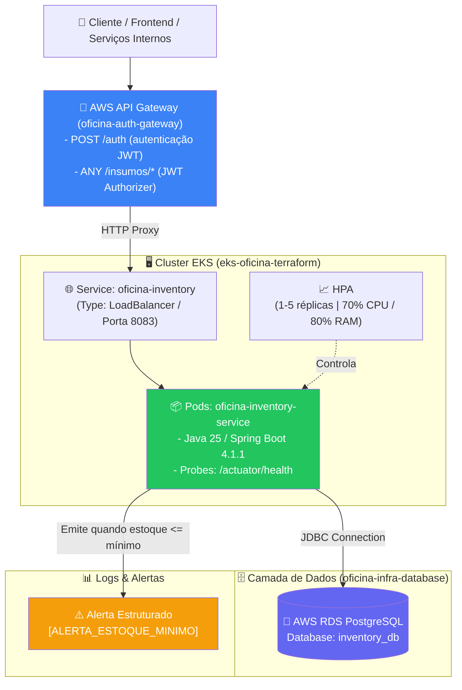
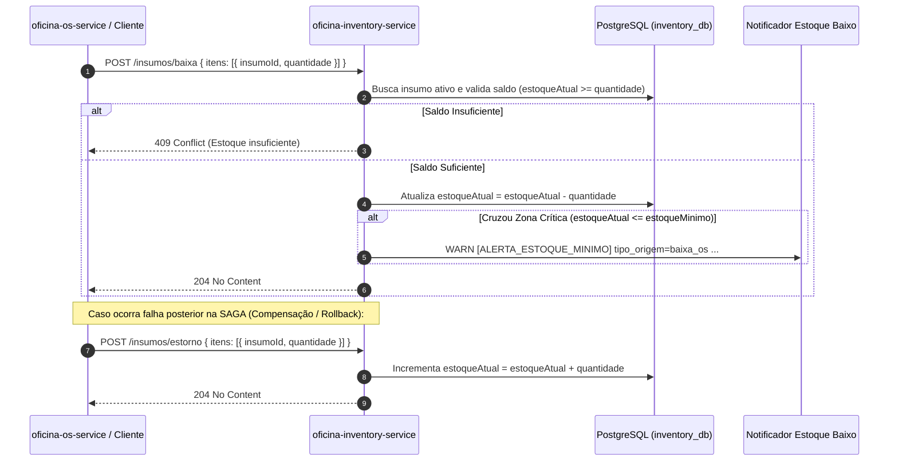

# Oficina Inventory Service

Microsserviço de **Gestão de Insumos e Controle de Estoque** da oficina mecânica, responsável pelo catálogo de peças e materiais (`Insumos`), entrada por compra simulada, **baixa de estoque em lote** para Ordens de Serviço com emissão automática de **alertas estruturados de estoque crítico** (`[ALERTA_ESTOQUE_MINIMO]`), e **estorno em lote** para compensação transacional (**SAGA Pattern**).

Desenvolvido como parte do ecossistema de microsserviços da pós-graduação **SOAT (Software Architecture) da FIAP**.

---

## 🛠️ Stack Tecnológica

| Componente | Tecnologia | Versão / Detalhes |
| :--- | :--- | :--- |
| **Linguagem** | Java | 25 (compatível com 21+) |
| **Framework Base** | Spring Boot | 4.1.1 (Spring WebMvc, Spring Data JPA, Spring Validation) |
| **Banco de Dados Principal** | PostgreSQL | 15 (Alpine via Docker) |
| **Banco de Dados em Memória** | H2 Database | Perfil `local` para testes e desenvolvimento rápido |
| **ORM / Persistência** | Hibernate ORM | 7.4.x |
| **Automação de Build** | GNU Make | `Makefile` cross-platform (Windows / Linux / macOS) |
| **Conteinerização** | Docker & Docker Compose | Multi-stage build com `eclipse-temurin:25` |
| **Orquestração de Contêineres** | Kubernetes & Kustomize | `k8s/base` + `k8s/overlays/aws` (HPA, Deployment, Service) |
| **Registry de Imagens** | Amazon ECR | Repositório `oficina-inventory-service` (tags imutáveis) |
| **Deploy & CI/CD** | GitHub Actions | Pipelines independentes de CI (`maven.yml`) e CD (`deploy.yml`) |
| **Monitoramento & Saúde** | Spring Boot Actuator | `/actuator/health` (liveness, readiness e startup probes) |
| **Documentação da API** | SpringDoc OpenAPI | 3.1.0 (Swagger UI v3) |
| **Produtividade** | Lombok | 1.18.x |
| **Testes Unitários / Integração** | JUnit 5 & Mockito | 84 testes automatizados via Maven Surefire |
| **Testes E2E / API Client** | Bruno | Coleção completa de requisições em `src/test/bruno/` |

---

## 🏛️ Arquitetura

O microsserviço segue os princípios da **Clean Architecture (Arquitetura Limpa)** e **Ports & Adapters (Arquitetura Hexagonal)**, com as dependências fluindo sempre de fora para dentro:

```
[ Adapters: Web / Persistence / Notification ] ──> [ Application: Use Cases / Gateways ] ──> [ Domain: Entidades / Regras de Negócio ]
```

* **`domain/insumo/`**: Entidades de negócio puras ([`Insumos`](src/main/java/com/mecanica/oficina_inventory_service/domain/insumo/Insumos.java) e [`OrigemNotificacaoEstoque`](src/main/java/com/mecanica/oficina_inventory_service/domain/insumo/OrigemNotificacaoEstoque.java)) e regras invariantes (validação de saldos, baixa com trava de estoque insuficiente e detecção inteligente de cruzamento da zona de estoque crítico sem spam). Não possui dependências do framework Spring nem de infraestrutura externa.
* **`application/insumo/`**: Casos de uso (`CadastrarInsumoUseCase`, `ConsultarInsumoUseCase`, `ListarInsumosUseCase`, `AlterarInsumoUseCase`, `AtivarInsumoUseCase`, `InativarInsumoUseCase`, `RegistrarCompraUseCase`, `BaixarEstoqueUseCase`, `EstornarEstoqueUseCase`) e interfaces de saída (`InsumosGateway`, `NotificarEstoqueBaixoGateway`).
* **`adapters/`**:
  * `web/`: Controlador REST ([`InsumosController`](src/main/java/com/mecanica/oficina_inventory_service/adapters/web/InsumosController.java)), Presenter ([`InsumosPresenter`](src/main/java/com/mecanica/oficina_inventory_service/adapters/web/presenter/InsumosPresenter.java)), DTOs e tratamento global de exceções ([`GlobalExceptionHandler`](src/main/java/com/mecanica/oficina_inventory_service/adapters/web/GlobalExceptionHandler.java)).
  * `persistence/`: Entidade JPA (`InsumosJpaEntity`), repositório Spring Data (`InsumosSpringDataRepository`) e gateway de persistência (`InsumosJpaGateway`).
  * `notification/`: Emissor de alertas estruturados de estoque crítico em linha única parseável por Loki/Grep ([`LogNotificadorEstoqueBaixo`](src/main/java/com/mecanica/oficina_inventory_service/adapters/notification/LogNotificadorEstoqueBaixo.java)).
  * `config/`: Injeção de dependências dos casos de uso ([`InsumoConfig`](src/main/java/com/mecanica/oficina_inventory_service/adapters/config/InsumoConfig.java)).

### 🌐 Integração no Ecossistema de Microsserviços e AWS

O microsserviço de estoque opera como um serviço autônomo dentro do ecossistema distribuído da oficina na AWS:



#### Papel dos Repositórios Integrados:
* **[`oficina-infra-cluster`](../oficina-infra-cluster)**: Provisiona a VPC, Subnets, o cluster EKS (`eks-oficina-terraform`) e o repositório ECR (`oficina-inventory-service`).
* **[`oficina-infra-database`](../oficina-infra-database)**: Provisiona a instância PostgreSQL compartilhada no RDS; os dados de estoque ficam isolados na base `inventory_db` (*Database-per-Service*).
* **[`oficina-auth-gateway`](../oficina-auth-gateway)**: Ponto único de entrada com autenticação JWT para os endpoints de estoque (`/insumos/*`).
* **[`oficina-inventory-service`](.)**: Repositório do microsserviço com pipeline de CD independente, aplicando manifestos Kustomize diretamente no cluster EKS.

---

## 📚 Documentação Adicional

Para instruções operacionais e detalhes do ciclo de vida na nuvem, consulte a pasta [`docs/`](docs/):

* 🚀 **[Guia de Deploy e Destruição na AWS (EKS + RDS + CD)](docs/deploy-aws.md):** Manual completo com o passo a passo de subida das esteiras de CI/CD, configuração de credenciais no Learner Lab, testes na nuvem e o **roteiro obrigatório de destruição da infraestrutura**.
* 📨 **[Mensageria (SNS + SQS)](docs/mensageria.md):** Outbox, consumidor idempotente, DLQ e LocalStack para a Saga coreografada.
* 📋 **[Plano de Implementação e Extração do `oficina-inventory-service`](docs/plano-implementacao-inventory-service.md):** Detalhamento das decisões arquiteturais, estrutura de pacotes e resgate das regras de baixa/estorno de estoque.

---

## 🗄️ Banco de Dados e Justificativa da Escolha

O banco de dados relacional **PostgreSQL 15** foi selecionado como banco principal do serviço pelos seguintes motivos técnicos:

1. **Garantias ACID e Controle de Saldo em Lote**:
   * O controle de estoque exige consistência estrita para evitar saldo negativo (*overselling*) quando múltiplas Ordens de Serviço requisitam peças simultaneamente. O PostgreSQL garante transações atômicas na baixa e no estorno em lote.
2. **Precisão Monetária Exata**:
   * Uso nativo do tipo `numeric(12,2)` para persistência do `preco_unitario` de cada insumo, evitando desvios de arredondamento de ponto flutuante (`float`/`double`).
3. **Exclusão Lógica (Soft Delete) e Histórico**:
   * Preservação de insumos desativados (`ativo = false`) com possibilidade de reativação futura via `PATCH /insumos/{id}/ativar`, mantendo a rastreabilidade histórica de peças já utilizadas.
4. **Identificadores Universais (`UUID`)**:
   * Uso nativo de `UUID` como chave primária da tabela `insumos`, facilitando a referência cruzada assíncrona em eventos de mensageria e SAGA sem acoplamento de chave estrangeira física entre bancos distintos.
5. **Banco H2 Auxiliar (In-Memory)**:
   * Disponibilizado sob o perfil `local` para acelerar o desenvolvimento e viabilizar a execução imediata dos **84 testes automatizados** em pipelines de CI/CD sem depender de containers externos.

---

## 📦 Fluxo de Baixa de Estoque, Alerta Crítico e Estorno (SAGA Ready)

O microsserviço expõe operações atômicas em lote desenhadas tanto para chamadas REST quanto para os futuros consumidores de eventos da **SAGA Coreografada**:



### Exemplo de Requisição: `POST /insumos/baixa`
```http
POST /insumos/baixa HTTP/1.1
Host: localhost:8083
Content-Type: application/json

{
  "itens": [
    {
      "insumoId": "9b1deb4d-3b7d-4bad-9bdd-2b0d7b3dcb6d",
      "quantidade": 4
    }
  ]
}
```

### Exemplo de Alerta Emitido no Log (`LogNotificadorEstoqueBaixo`):
```text
WARN [ALERTA_ESTOQUE_MINIMO] tipo_origem=baixa_os insumo_id=9b1deb4d-3b7d-4bad-9bdd-2b0d7b3dcb6d nome_insumo=Óleo 5W30 estoque_anterior=12 estoque_atual=8 estoque_minimo=10 referencia_origem={}
```

---

## ✅ Testes e qualidade

[](https://sonarcloud.io/summary/overall?id=GrupoPosTech-FIAP_oficina-inventory-service) [](https://sonarcloud.io/component_measures?id=GrupoPosTech-FIAP_oficina-inventory-service&metric=coverage)

```bash
./mvnw clean verify   # testes + relatório e gate do JaCoCo
```

- **Cobertura:** o JaCoCo reprova o `verify` abaixo de **80% de linhas**. Hoje: **97,1%** (125 testes).
  Relatório em `target/site/jacoco/index.html`; o CI escreve o percentual no resumo de cada execução.
- **Qualidade:** o CI ([`maven.yml`](.github/workflows/maven.yml)) analisa o código no
  [SonarCloud](https://sonarcloud.io/summary/overall?id=GrupoPosTech-FIAP_oficina-inventory-service) e o build falha se o
  quality gate reprovar. A análise roda quando o secret `SONAR_TOKEN` existe na organização.

## 🚀 Como Executar

### Pré-requisitos
* **Docker e Docker Compose** instalados (ou ferramenta `make`).
* **Java 25** (ou JDK 21+) caso deseje compilar ou executar fora do container.

---

### Execução via `make` (Padrão Recomendado)

O projeto conta com um [`Makefile`](Makefile) padronizado, compatível com o ecossistema da oficina:

| Comando | Descrição |
| :--- | :--- |
| `make start` | Limpa volumes antigos, compila a imagem Docker e sobe o `inventory-app` e `inventory-db` com logs. |
| `make dev` | Sobe apenas o PostgreSQL via Docker e aguarda ficar pronto (`pg_isready`), liberando o terminal para rodar o backend localmente na IDE. |
| `make debug` | Sobe o PostgreSQL e inicia o Spring Boot local com suporte a **Remote JVM Debug na porta 5007** (Attach na IDE). |
| `make up` | Sobe os containers em segundo plano (`docker compose up -d`). |
| `make down` | Para os containers e remove volumes criados. |
| `make build` | Compila o projeto e gera o arquivo `.jar` pulando testes. |
| `make logs` | Exibe os logs em tempo real da aplicação (`inventory-app`). |
| `make logs-db` | Exibe os logs em tempo real do banco de dados (`inventory-db`). |
| `make test` | Executa todos os 84 testes unitários, de slice e de persistência via Maven. |
| `make test-e2e` | Executa os testes de API de ponta a ponta com o Bruno CLI (`caminho-feliz`). |
| `make clean` | Executa o clean do Maven e remove imagens/volumes locais do Docker. |
| `make info` | Exibe no terminal as portas e URLs de acesso da aplicação e do banco. |

---

### Execução Manual sem `make`

#### Opção 1: Via Docker Compose Direto
```bash
docker compose up --build
```

#### Opção 2: Banco em Memória H2 (Desenvolvimento Rápido sem Docker)
```powershell
# Windows
.\mvnw.cmd spring-boot:run "-Dspring-boot.run.profiles=local"

# Linux / macOS
./mvnw spring-boot:run -Dspring-boot.run.profiles=local
```

#### Opção 3: PostgreSQL via Docker + Spring Boot Local
```powershell
# 1. Sobe apenas o banco
docker compose up -d inventory-db

# 2. Inicia o serviço apontando para o banco
.\mvnw.cmd spring-boot:run "-Dspring-boot.run.profiles=default"
```

---

### Endpoints e Interfaces Úteis

* **Swagger UI (Documentação Interativa OpenAPI):** [http://localhost:8083/swagger-ui.html](http://localhost:8083/swagger-ui.html)
* **OpenAPI Docs (JSON):** [http://localhost:8083/v3/api-docs](http://localhost:8083/v3/api-docs)
* **H2 Web Console (quando no perfil `local`):** [http://localhost:8083/h2-console](http://localhost:8083/h2-console)
  * *JDBC URL:* `jdbc:h2:mem:inventory_db`
  * *User Name:* `sa`
  * *Password:* *(deixar em branco)*
* **Spring Boot Actuator Health:** [http://localhost:8083/actuator/health](http://localhost:8083/actuator/health)
* **Spring Boot Actuator Info:** [http://localhost:8083/actuator/info](http://localhost:8083/actuator/info)

---

### Variáveis de Ambiente Suportadas

| Variável | Descrição | Valor Padrão |
| :--- | :--- | :--- |
| `SERVER_PORT` / `APP_PORT` | Porta HTTP da aplicação | `8083` |
| `DB_PORT` | Porta mapeada do PostgreSQL no host | `5432` |
| `POSTGRES_DB` | Nome do banco de dados | `inventory_db` |
| `POSTGRES_USER` | Usuário do PostgreSQL | `postgres` |
| `POSTGRES_PASSWORD` | Senha do PostgreSQL | `123` |
| `SPRING_DATASOURCE_URL` | URL JDBC do PostgreSQL | `jdbc:postgresql://localhost:5432/inventory_db` |
| `SPRING_PROFILES_ACTIVE` | Perfil ativo do Spring Boot | `default` (ou `local` para H2) |

---

## 📊 Observabilidade

A imagem roda com o agente do **OpenTelemetry** (como na app-api, ADR 002), que exporta traces, métricas e logs por OTLP
para o **New Relic** como `service.name=oficina-inventory-service` (`service.namespace=oficina`). O agente captura HTTP, banco, SNS/SQS
e o relay do outbox sem dependência no código; os logs da Saga trazem `saga_id` e `event_type` para acompanhar uma OS
entre os serviços. Consultas NRQL e alertas: [monitoramento e observabilidade](https://github.com/GrupoPosTech-FIAP/oficina-app-api/blob/main/docs/monitoramento-e-observabilidade.md).

- **AWS:** as variáveis `OTEL_*` ficam no `k8s/base/configmap.yaml`; o `deploy.yml` monta a license key a partir do
  secret `NEW_RELIC_LICENSE_KEY` e desliga o agente (`OTEL_SDK_DISABLED=true`) quando ele não existe.
- **Local:** no `docker-compose` o agente vem desligado; para ligar, defina `NEW_RELIC_LICENSE_KEY` e
  `OTEL_SDK_DISABLED=false` no `.env`.

## ☁️ Deploy e Infraestrutura Kubernetes (K8s & CI/CD Independente)

O `oficina-inventory-service` possui ciclo de vida e **Continuous Deployment (CD) 100% desacoplado**, utilizando Kustomize para gerenciar os manifestos declarativos do Kubernetes e GitHub Actions para a automação.

### 📁 Estrutura de Manifestos Kustomize (`k8s/`)

```
k8s/
├── base/
│   ├── kustomization.yaml           # Orquestrador base de recursos
│   ├── app-deployment.yaml          # Pods, portas (8083), recursos e probes
│   ├── app-service.yaml             # Service ClusterIP (porta 8083)
│   ├── app-hpa.yaml                 # Autoscaler horizontal (1-5 réplicas)
│   └── configmap.yaml               # Variáveis de ambiente não sensíveis
└── overlays/
    └── aws/
        ├── kustomization.yaml       # Aplica patches e substitui imagem do ECR
        ├── service-loadbalancer.yaml# Promove o Service a LoadBalancer na AWS
        ├── configmap-rds.yaml       # Injeta dinamicamente o endpoint do RDS
        ├── secret.example.yaml      # Modelo documental de secrets
        └── secret.yaml              # Gerado efemeramente na pipeline (no .gitignore)
```

### ⚙️ Recursos Kubernetes Gerenciados:
1. **Deployment (`app-deployment.yaml`)**:
   * Executa a imagem imutável publicada no Amazon ECR (`oficina-inventory-service`).
   * Configura limites e reservas de recursos: `requests: { cpu: 250m, memory: 512Mi }` e `limits: { cpu: 500m, memory: 768Mi }`.
   * **Probes de Saúde (Actuator)**:
     * `startupProbe`: aguarda a inicialização do Spring Boot (até 150s) sem matar o pod antecipadamente.
     * `readinessProbe`: verifica `/actuator/health` na porta `8083` antes de enviar tráfego do Service.
     * `livenessProbe`: verifica a estabilidade contínua da aplicação.
2. **Service (`app-service.yaml` + overlay `service-loadbalancer.yaml`)**:
   * Expõe a porta `8083` da aplicação.
   * Na AWS, o patch Kustomize converte o tipo para `LoadBalancer`, disponibilizando um endereço ELB para integração pelo API Gateway.
3. **Horizontal Pod Autoscaler (`app-hpa.yaml`)**:
   * Escala automaticamente a quantidade de pods entre **1 (mínimo)** e **5 (máximo)** baseado na utilização média de 70% de CPU ou 80% de memória.
4. **ConfigMap & Secret (`configmap.yaml`, `secret.yaml`)**:
   * Separação estrita de configuração (`inventory-config`) e segredos (`inventory-secret`).
   * O arquivo `secret.yaml` é gerado efemeramente durante a execução da esteira de CD e é ignorado no Git via [`.gitignore`](.gitignore).

---

### 🔁 Pipeline de CD via GitHub Actions ([`.github/workflows/deploy.yml`](.github/workflows/deploy.yml))

A publicação no cluster EKS da AWS é automatizada e independente dos demais microsserviços:

* **Gatilhos de Execução:**
  * **Manual (`workflow_dispatch`)**: Requer o input `rds_endpoint` (obtido com `terraform output -raw DB_Endpoint` no repositório `oficina-infra-database`).
  * **Automático**: Ao publicar uma tag Git versionada (ex: `v1.0.0`).

* **Etapas da Pipeline de CD:**
  1. **Checkout & Versionamento**: Determina a tag da imagem (tag Git ou `GITHUB_SHA` curto).
  2. **Autenticação AWS & Login ECR**: Conecta-se à AWS e realiza login no registro de contêineres.
  3. **Build & Push Docker**: Constrói a imagem baseada em Java 25 e faz push para o ECR `oficina-inventory-service`.
  4. **Kubeconfig EKS**: Configura as credenciais de acesso ao cluster `eks-oficina-terraform`.
  5. **Injeção de Secrets e Configuração**:
     * Gera o `k8s/overlays/aws/secret.yaml` em Base64 com o secret `RDS_PASSWORD`.
     * Atualiza dinamicamente o `kustomization.yaml` com o registry e tag da imagem recém-construída.
     * Injeta o `rds_endpoint` informado no `configmap-rds.yaml`.
  6. **Deploy & Rollout**: Executa `kubectl apply -k k8s/overlays/aws` e valida a estabilização com `kubectl rollout status deploy/oficina-inventory`.

#### 🔐 Secrets Necessários no Repositório GitHub

| Secret | Descrição | Origem |
| :--- | :--- | :--- |
| `AWS_ACCESS_KEY_ID` | Chave de acesso AWS | AWS Learner Lab / IAM |
| `AWS_SECRET_ACCESS_KEY` | Chave secreta AWS | AWS Learner Lab / IAM |
| `AWS_SESSION_TOKEN` | Token temporário de sessão | AWS Learner Lab |
| `RDS_PASSWORD` | Senha master do PostgreSQL | Mesma senha de `oficina-infra-database` |
| `NEW_RELIC_LICENSE_KEY` | License key de ingestão do New Relic (opcional; sem ela o agente fica desligado) | New Relic > API Keys |

#### 🧪 Validação Local dos Manifestos (sem aplicar no cluster):
```bash
# Renderiza todos os objetos combinados pelo Kustomize para validação visual
kubectl kustomize k8s/overlays/aws
```

---

## 🧪 Como Executar os Testes

O projeto adota uma estratégia de testes em duas camadas: **Testes Automatizados (Domínio, Casos de Uso, Persistência JPA e Controller REST)** e **Testes de Contrato E2E**.

### 1. Testes Automatizados (Maven)

A suíte possui **84 testes automatizados** cobrindo regras de domínio (`InsumoTest`), todos os 9 casos de uso (incluindo `BaixarEstoqueUseCaseTest` e `EstornarEstoqueUseCaseTest`), mapeamento de apresentação (`InsumosPresenterTest`), persistência relacional com H2 (`InsumosJpaGatewayTest`) e contratos HTTP/validação de campos (`InsumosControllerTest`).

* **Via Make:**
  ```bash
  make test
  ```
* **Via Maven Wrapper:**
  ```powershell
  # Windows
  .\mvnw.cmd clean test

  # Linux / macOS
  ./mvnw clean test
  ```

* **Executar classe de teste específica:**
  ```powershell
  # Regras de domínio, baixa de estoque e gatilhos de alerta crítico
  .\mvnw.cmd test -Dtest=InsumoTest

  # Baixa e estorno de estoque em lote (SAGA)
  .\mvnw.cmd test -Dtest=BaixarEstoqueUseCaseTest,EstornarEstoqueUseCaseTest

  # Controller REST e validações de payload (400 / 404 / 409)
  .\mvnw.cmd test -Dtest=InsumosControllerTest

  # Persistência JPA com banco H2
  .\mvnw.cmd test -Dtest=InsumosJpaGatewayTest
  ```

---

### 2. Testes E2E com Bruno (API Client)

A coleção completa de requisições está disponível em [`src/test/bruno/`](src/test/bruno/).

#### Suíte Sequencial do Caminho Feliz (`caminho-feliz/`):
1. `01 - Cadastrar Insumo`: Gera nome único dinamicamente, cadastra o insumo (`estoqueAtual = 20`, `estoqueMinimo = 5`) e salva o `insumoId` (`201 Created`).
2. `02 - Buscar Insumo por ID`: Valida os dados do insumo cadastrado (`200 OK`).
3. `03 - Listar Insumos Ativos`: Lista todos os insumos ativos no catálogo (`200 OK`).
4. `04 - Alterar Insumo`: Atualiza preço, `estoqueAtual = 25` e `estoqueMinimo = 10` (`204 No Content`).
5. `05 - Compra Simulada de Insumo`: Incrementa `+15` unidades no estoque, validando `estoqueAtual == 40` (`200 OK`).
6. `06 - Baixar Estoque em Lote (OS)`: Deduz `32` unidades (`POST /insumos/baixa`), levando o estoque para `8` (abaixo do mínimo `10` e emitindo `[ALERTA_ESTOQUE_MINIMO]`) (`204 No Content`).
7. `07 - Estornar Estoque em Lote (Rollback SAGA)`: Devolve `+2` unidades (`POST /insumos/estorno`), restaurando o estoque para `10` (`204 No Content`).
8. `08 - Desativar Insumo (Soft Delete)`: Inativa o insumo no catálogo (`204 No Content`).
9. `09 - Reativar Insumo`: Reativa o insumo e confirma `ativo == true` e `estoqueAtual == 10` (`200 OK`).

#### Executando via Bruno Desktop:
1. Abra o aplicativo [Bruno](https://www.usebruno.com/).
2. Selecione **Open Collection** e selecione a pasta `src/test/bruno/`.
3. Escolha o ambiente **`local`** no canto superior direito.
4. Clique com o botão direito na pasta **`caminho-feliz`** e selecione **Run Folder**.

#### Executando via Linha de Comando (Bruno CLI):
```bash
# Via Make:
make test-e2e

# Ou diretamente via npx (a partir da raiz da coleção):
cd src/test/bruno && npx @usebruno/cli run caminho-feliz --env local
```

---

## 📄 Licença

Distribuído sob a licença [MIT](LICENSE).
