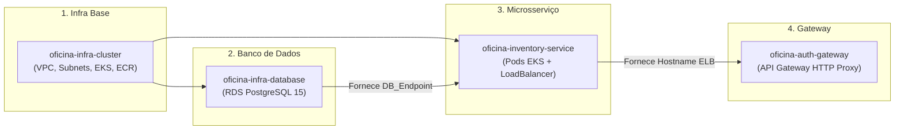

# 🚀 Guia de Deploy e Destruição na AWS (EKS + RDS + CD Independente)

Este guia orienta o processo completo para provisionar, implantar, testar e posteriormente destruir todos os recursos do **`oficina-inventory-service`** na nuvem da **AWS**, com foco na esteira automatizada de Continuous Deployment (CD) e na gestão eficiente de créditos do **AWS Learner Lab / AWS Academy**.

---

## 🧭 Visão Geral do Ecossistema

O `oficina-inventory-service` se conecta à infraestrutura compartilhada gerenciada pelos demais repositórios do grupo:



---

## 🔑 1. Pré-requisitos & AWS Learner Lab

Como as sessões do **AWS Learner Lab** expiram a cada ~4 horas:

1. Acesse o painel do **AWS Academy** e clique em **Start Lab** (aguarde o status ficar verde).
2. Clique no botão **AWS Details** e copie as credenciais temporárias:
   * `AWS_ACCESS_KEY_ID`
   * `AWS_SECRET_ACCESS_KEY`
   * `AWS_SESSION_TOKEN`
3. Atualize esses 3 Secrets no GitHub (**Settings > Secrets and variables > Actions**) nos repositórios que serão executados:
   * [`oficina-infra-cluster`](../../oficina-infra-cluster)
   * [`oficina-infra-database`](../../oficina-infra-database)
   * [`oficina-inventory-service`](../)

### 🔐 Secret adicional necessário em `oficina-inventory-service`:

| Secret | Descrição |
| :--- | :--- |
| `RDS_PASSWORD` | Senha master definida para o banco RDS PostgreSQL (mesmo valor de `oficina-infra-database`). |

---

## 🗄️ 2. Particularidade do Banco de Dados (`inventory_db`)

Para economizar os créditos limitados do Learner Lab, o serviço utiliza a **mesma instância física do RDS** criada por `oficina-infra-database`, porém isolado em um **database lógico exclusivo (`inventory_db`)**.

Como o Terraform do RDS cria apenas a base padrão `oficina_db`, na **primeira vez** que a instância RDS for provisionada, execute via client SQL conectado ao RDS:
```sql
CREATE DATABASE inventory_db;
```
*(Após isso, o Spring Boot/Hibernate criará automaticamente a tabela `insumos`).*

---

## 🚀 3. Roteiro de Subida via CI/CD (Ordem Obrigatória)

### Passo 3.1: Subir a Infraestrutura Base (`oficina-infra-cluster`)
1. No repositório [`oficina-infra-cluster`](../../oficina-infra-cluster), vá na aba **Actions** e selecione o workflow **Terraform - CI/CD** (`deploy.yml`).
2. Clique em **Run workflow** e informe `TF_BUCKET_NAME`.
3. Aguarde a conclusão (~10 a 15 minutos). Isso criará a VPC, Subnets, o cluster EKS `eks-oficina-terraform` e o repositório ECR `oficina-inventory-service`.

---

### Passo 3.2: Subir o Banco de Dados RDS (`oficina-infra-database`)
1. No repositório [`oficina-infra-database`](../../oficina-infra-database), vá na aba **Actions** e selecione **RDS - CI/CD** (`deploy.yml`).
2. Clique em **Run workflow** e informe o mesmo `TF_BUCKET_NAME`.
3. Ao término do workflow, copie o valor do `DB_Endpoint`.

---

### Passo 3.3: Deploy do `oficina-inventory-service` (CD Independente)
1. No repositório [`oficina-inventory-service`](../), vá na aba **Actions** e selecione o workflow **CD - Deploy na AWS (EKS)** (`deploy.yml`).
2. Clique em **Run workflow**.
3. No campo `rds_endpoint`, cole o endpoint obtido no passo anterior (sem a porta `:5432`).
4. Confirme a execução. A esteira irá compilar a imagem Docker, enviar para o ECR `oficina-inventory-service`, aplicar os manifestos via Kustomize (`kubectl apply -k k8s/overlays/aws`) e aguardar o rollout de `deploy/oficina-inventory`.

---

### Passo 3.4 (Opcional): Subir o API Gateway (`oficina-auth-gateway`)
1. Obtenha o hostname externo do LoadBalancer gerado pelo inventory (`kubectl get svc oficina-inventory`).
2. No repositório [`oficina-auth-gateway`](../../oficina-auth-gateway), acione o workflow de deploy informando o `inventory_service_base_url` (expondo a rota protegida `ANY /inventory/{proxy+}`).

---

## 🧪 4. Como Validar e Testar na AWS

```bash
# Atualiza o contexto local do kubectl
aws eks update-kubeconfig --name eks-oficina-terraform --region us-east-1

# Obtém o status dos pods
kubectl get pods -l app=oficina-inventory

# Obtém o endereço DNS do LoadBalancer
kubectl get svc oficina-inventory
```

Teste o Healthcheck e o cadastro de insumo:
```bash
curl -i http://<EXTERNAL-IP>:8083/actuator/health

curl -X POST http://<EXTERNAL-IP>:8083/insumos \
  -H "Content-Type: application/json" \
  -d '{
    "nome": "Óleo 5W30 Sintético",
    "precoUnitario": 45.90,
    "estoqueAtual": 20,
    "estoqueMinimo": 5,
    "unidade": "L"
  }'
```

---

## 🛑 5. Guia de Destruição (Para NÃO Gastar Créditos)

> [!CAUTION]
> **Apague primeiro o Service do Kubernetes antes de rodar `terraform destroy` no cluster EKS/VPC para liberar o Elastic Load Balancer (ELB) da AWS!**

```bash
# 1. Na raiz de oficina-inventory-service:
kubectl delete -k k8s/overlays/aws

# 2. Confirme que o Service foi removido:
kubectl get svc oficina-inventory
```
Em seguida, destrua na ordem: `oficina-auth-gateway` → `oficina-infra-database` → `oficina-infra-cluster` → **End Lab**.

